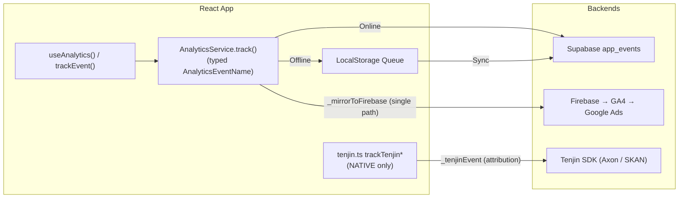

# Analytics System

This document describes the ONDA analytics system for tracking user behavior and product metrics.

## Overview

Every product event flows through **one typed wrapper** (`AnalyticsService.track()`)
and fans out to two sinks:

- **Supabase `app_events`** — first-party product analytics (funnels, retention),
  with an offline localStorage queue.
- **Firebase Analytics → GA4** — for Google Ads conversions / marketing. Mirrored
  from the same `track()` call. iOS via the Capacitor Firebase plugin; Android via
  `analytics-bridge`; web is a no-op.

Separately, **Tenjin** (`src/lib/tenjin.ts`, `trackTenjin*` helpers) sends **native**
MMP events (install attribution, AppLovin Axon, SKAdNetwork conversion values). These
are a *different* set of helpers with their own pooled `action_object` names and are
**not** the same as the Firebase events.

> **Single Firebase path (cleanup, cutover build 1.8.1 / 2026-06-13).** Firebase/GA4
> now receives events **only** through `AnalyticsService.track()`. Until then,
> `tenjin.ts` *also* mirrored every event into Firebase under a second naming
> convention, so each action landed in GA4 under two names (`start_practice` +
> `practice_start`, `view_paywall` + `paywall_view`, …). That Firebase mirror was
> removed; Tenjin native sends were left untouched. **Rule going forward:** the typed
> `AnalyticsEventName` enum is the single guard — add new events there and fire via
> `track()`; never open a second Firebase path. Variety goes in **params**, not names.

## Architecture



## Usage

### Basic Tracking

```typescript
import { useAnalytics } from './hooks/useAnalytics';

function MyComponent() {
  const { track, trackPractice, trackError } = useAnalytics();

  // Track simple events
  track('app_open', { platform: 'ios' });

  // Track practice events
  trackPractice('start', 'p1-1', { duration: 180 });
  trackPractice('complete', 'p1-1', { duration_seconds: 300 });

  // Track errors
  trackError('audio', 'Failed to load track', { url: '...' });
}
```

### Direct Service Access

```typescript
import { analytics, trackEvent } from './services/AnalyticsService';

// Direct function call
await trackEvent('sign_up', { method: 'email' });

// Identify user after sign-in
await analytics.identify(userId);

// Force flush queued events
await analytics.flush();
```

## Event Types

### Activation Events

| Event | Description | Metadata |
|-------|-------------|----------|
| `app_open` | App launched | `platform`, `cold_start` |
| `onboarding_start` | Onboarding begins — live one-screen first-run, or 3-screen tutorial replay | `source` (first_run\|menu), `featured_practice_id` / `att_copy_variant` |
| `onboarding_step` | Step view — **3-screen tutorial only** (the one-screen first-run has no steps) | `source` (menu), `step`, `total`, `permission` |
| `onboarding_complete` | Onboarding finished (was Tenjin `tutorial_complete`) | `source`, `completed_via` (cta\|skip — first_run only), `duration_seconds` |
| `home_view` | Main hub shown | `source` (first_run\|first_launch\|menu\|relaunch), `is_first` ('true'\|'false'), `mode`, `days_since_first_seen` |
| `sign_up` | User created account | `method` |
| `sign_in` | User signed in | `method` |

> **Canonical activation funnel** (filter `source = 'first_run'`): `first_open`
> (Firebase auto) → `onboarding_start` → `onboarding_complete` →
> `first_practice_complete` → `paywall_view` → `purchase`. The live new-install
> path is the one-screen first-run welcome. The legacy 3-screen tutorial is
> demoted to Menu → Intro and emits the same events with `source: 'menu'`, so
> manual replays stay OUT of the new-user funnel. `first_run_welcome_*` was
> folded in: the view = `onboarding_start`, the cta/skip outcome = `completed_via`.
>
> **Onboarding is disabled since 1.9.x** (`showFirstRun` hard-set to false), so
> the funnel above is ~0 for new installs. From **1.9.6** the new-user funnel is
> `first_open` → `home_view{source: first_launch}` → `practice_start` →
> `paywall_view` → `purchase`. `first_launch` = first-ever hub entry on the
> install (`is_first: 'true'`), claimed once via the Preferences-backed marker
> `onda_home_view_seen` (`claimFirstHomeView` in `src/lib/analyticsMarkers.ts`);
> every later launch is `relaunch` (`is_first: 'false'`).

### Permission Events

> **095 — read before comparing numbers across versions** (ships in the next
> release 1.9.5):
> - **`practice_start` double count removed.** Up to and including 1.9.4, starts
>   from the recommendation card (`recommend_static`) and the calm check-in push
>   fired `practice_start` twice (once at the intro, once when the session began).
>   From 1.9.5 it fires once, in `beginPractice`, with
>   `source` (home = level 1 grid, level = higher levels, recommend_static,
>   checkin = face/voice check, signal, push = calm check-in A1/B1, onboarding).
>   Do not compare `practice_start` counts across that seam directly.
> - **No boolean params.** Firebase/GA4 drops booleans ("(not set)"). Booleans are
>   a compile error in `track()` (`AnalyticsParams`/`NoBooleanParams`), callers use
>   `boolParam()`, and `track()` converts any remaining boolean to `"true"`/`"false"`
>   before every sink. Older versions show these params as "(not set)".


| Event | Description | Metadata |
|-------|-------------|----------|
| `health_permission` | HealthKit prompt resolved (deduped by granted-state — see note) | `scope`, `granted` |
| `att_prompt_result` | ATT prompt resolved | `status` |
| `notification_prompt_result` | Notification prompt resolved | `status` |
| `onboarding_permission_screen_view` | Permission screen shown | — |
| `watch_connection_attempt` | Trying to connect watch | — |
| `watch_connect_success` | Watch connected | `is_connected`, `is_first` (true only on first-ever connection; Capacitor Preferences flag `onda_watch_connected_ever`) |
| `notif_prompt_answered` | Notification system prompt answered | `trigger` (onboarding\|first_camera), `granted` (true\|false), `answer` (yes\|no) |
| `watch_connection_failed` | Watch connection failed | `error` |

> `health_permission` is deduped by the granted state (localStorage
> `onda_health_perm_logged`) because two HealthKit hooks re-check authorization —
> without the guard it fired ~15×/user. The Tenjin native side still fires per
> call (attribution).

### Practice Events

| Event | Description | Metadata |
|-------|-------------|----------|
| `practice_start` | Practice started (fires once, when the session begins) | `practice_type` (standard\|adaptive), `practice_id`, `has_biometrics`, `source` (home\|level\|recommend_static\|checkin\|signal\|push\|onboarding), `mode` |
| `practice_pause` | Practice paused | `practice_id` |
| `practice_resume` | Practice resumed | `practice_id` |
| `practice_complete` | Practice finished | `practice_type`, `practice_id`, `duration_seconds`, `time_percent`, `metrics_source`, `is_first`, `has_biometrics`, `is_valid_for_artifact` (time ≥ 80% only, 101), `ond_earned` |
| `practice_abandon` | Left without completing | `practice_type`, `practice_id`, `reason` (stop\|close\|incomplete) |
| `first_practice_complete` | First-ever valid completion (value-moment; fires once) | `practice_type` |

> **`practice_view` retired** (folded into `practice_start` — the counts were
> near-identical). **Adaptive vs standard is the `practice_type` param**, never a
> separate `*_adaptive_practice` event. The Tenjin native side keeps its pooled
> `start_practice`/`finish_practice` (+ per-practice slugs) for Axon.

### Biometric Events

| Event | Description | Metadata |
|-------|-------------|----------|
| `heart_rate_received` | HR data received | `source`, `value` |
| `biometric_sync_success` | Data synced successfully | `source` |
| `biometric_sync_failed` | Sync failed | `source`, `error` |

### Gamification Events

| Event | Description | Metadata |
|-------|-------------|----------|
| `ond_earned` | User earned OND | `amount`, `source` |
| `artifact_unlocked` | New artifact obtained | `artifact_id` |
| `level_up` | User leveled up | `new_level` |

### Paywall / Monetization Events

| Event | Description | Metadata |
|-------|-------------|----------|
| `paywall_view` | Subscription screen opened | `source` |
| `paywall_dismiss` | Closed without subscribing | `source`, `plan`, `time_on_screen_seconds` |
| `paywall_cta_tap` | Tapped the purchase CTA | `plan`, `product_id` |
| `plan_select` | Switched plan on the paywall (101) | `plan` |
| `purchase_cancelled` | Cancelled in the StoreKit sheet (101) | `plan`, `error_code` |
| `purchase_failed` | Purchase error other than cancel (101) | `plan`, `error_code` |
| `home_tap` | Main-home tap, first session only (101) | `target`, `is_first_session` |
| `paywall_feedback` | One-time "what stopped you?" after a paywall closed without purchase; never again after answer/dismiss; never for internal traffic (101) | `reason` (price\|try_first\|unclear_value\|other), `paywall_source` |
| `trial_start` | Free trial started ($0 at Apple; only periodType TRIAL/INTRO, 096) | `product_id`, `plan`, `period_type`, `paywall_source` |
| `trial_outcome` | Trial decided — once per trial, on the first app open after it (101) | `outcome` (converted\|expired), `plan`, `trial_days`, `practices_in_trial`, `days_active_in_trial`, `watch_connected`, `baseline_filled` |
| `purchase` | Real paid conversion — Firebase **ecommerce**, keep this name | `value`, `currency`, `product_id`, `plan`, `paywall_source` |
| `purchase_failed` | Purchase threw | `plan`, `error` |
| `purchase_cancelled` | User cancelled the StoreKit sheet | `plan` |

> `purchase` fires from `useSubscription` **only on a genuine not-paid → paid
> (NORMAL) transition** — never on restore, login-restore, reinstall (pre-existing
> sub on first load), or renewal (active→active with only the date moved). Those
> are recorded as a paid-state baseline (`onda_sub_paid_state`) instead; renewals
> are counted server-side as `subscription_renew` via the RevenueCat webhook. The
> off-app trial→paid flip still counts, because the baseline persists across
> launches. Keep the name `purchase` + `value`/`currency` so GA4 counts it as
> revenue. Trial start ($0) is `trial_start`, never `purchase` (old phantom bug).

#### paywall_source and trial_outcome (task 101, 1.9.7)

Round 2 (101):
- `paywall_dismiss` gains `paywall_source` (same name as on purchase/trial_start) and
  `seconds_on_paywall` (string, whole seconds); `source`, `action`,
  `time_on_screen_seconds` stay for series continuity.
- `plan_select {plan}` — only on an actual plan switch on the paywall.
- `purchase_cancelled {plan, error_code:'user_cancelled'}` — StoreKit sheet cancel
  (RevenueCat userCancelled / code 1). `purchase_failed {plan, error_code}` — any other
  error, RevenueCat `readableErrorCode`/code only (the old `error` = message param is
  gone: possible PII); `no_entitlement` when the purchase returned without premium.
  Before 101 every hook-level failure was swallowed and reported as `purchase_cancelled`.
  No `purchase_error` event ever existed.
- `home_tap {target, is_first_session:'true'}` — FIRST SESSION ONLY (`src/lib/firstSession.ts`):
  starts when the first-ever hub entry is claimed (home_view first_launch), ends at the
  first background/terminate or after 30 min; end persisted (`onda_first_session_ended`).
  Upgraders never get a first session. Each target once per session, max 25. Targets:
  `practice:<id>`, `menu`, `menu_<item>` (menu_settings, menu_diary…), `diary`,
  `connect_cta`, `watch_connect`, `camera_checkin`, `camera_stop`, `recommendation`,
  `signal_practice`, `signal_cta`, `voice_check`, `face_check`, `baseline_shift`,
  `baseline_card`, `simple_restore` (`src/lib/homeTap.ts`).
- Debug panels (🧪 Test signals, Fire entry events, 🌿 Calm check-ins, 📨 Real push test)
  render only when `VITE_INTERNAL_BUILD === 'true'` (`src/lib/buildFlags.ts`); in App Store
  builds the 7-tap only marks the device internal (badge).

- **`paywall_source`** = `source` of the last `paywall_view` (`post_first_experience`,
  `practice_gate_basic`; the modal also stores whatever `source` prop it was opened
  with). Persisted in Capacitor Preferences (`onda_last_paywall_source`, mirrored to
  localStorage) by `src/lib/trialOutcome.ts#recordPaywallSource`. Sent on
  `trial_start` and `purchase`; `'unknown'` if no paywall was ever seen on this install.
  **Kept after a purchase, not cleared**: a trial's `purchase` fires days later on the
  trial→paid flip and must still name the paywall that started the trial; the next
  `paywall_view` overwrites it.
- **`trial_outcome`**: on `trial_start` a trial marker is stored
  (`onda_trial_marker_v1`: start, product, plan, trial length = product intro offer if
  known else 7 d monthly / 14 d yearly, practice-history length at start, local day keys).
  Every app open / resume adds the local day (only before the trial end). On every
  customerInfo load/update `useSubscription` evaluates `entitlements.all[premium]`:
  periodType `NORMAL` → `converted`; still `TRIAL/INTRO` and active (also
  cancelled-but-in-trial) → pending; inactive with its expiry passed, or missing after
  the expected end → `expired`. Sent once per trial (claim `onda_trial_outcome_sent` =
  startedAt, serialized), then the marker is cleared. `practices_in_trial` = practice
  history entries dated between start and min(now, trial end); `watch_connected` = 095
  first-watch marker; `baseline_filled` = `onda_baseline_filled_tracked`. All params are
  strings. No health values.
- Limits: a user who never reopens the app after the trial → no `trial_outcome`
  (use RevenueCat / the webhook for the full picture); a reinstall loses the marker;
  Family Sharing / another device's trial isn't seen; a refund after conversion still
  reads `converted` (refunds belong to the webhook).

### Diagnostics Events

| Event | Description | Metadata |
|-------|-------------|----------|
| `app_crash_suspected` | Stale practice marker found on next launch (iOS WebView OOM) | — |
| `practice_intro_closed_debug` | **dev-only** — dropped in prod | … |
| `resource_snapshot` | **dev-only** — memory snapshot, dropped in prod | … |

> `practice_intro_closed_debug` and `resource_snapshot` are gated behind
> `const ANALYTICS_DEBUG = false` in `AnalyticsService.ts` and never reach
> Firebase/Supabase in prod (they were leaking ~214 events/build into GA4). Flip
> the flag locally to re-enable.

### Error Events

| Event | Description | Metadata |
|-------|-------------|----------|
| `error` | Generic error | `error_type`, `message` |
| `audio_load_error` | Audio failed to load | `url`, `error` |
| `api_error` | API call failed | `endpoint`, `status` |

## Database Schema

```sql
create table app_events (
  id uuid default gen_random_uuid() primary key,
  created_at timestamptz default now(),
  
  -- User identification
  user_id uuid references auth.users(id),
  anonymous_id text,     -- For pre-sign-in tracking
  session_id uuid,       -- Group events by session
  
  -- Event data
  event_name text not null,
  platform text,         -- 'ios', 'android', 'web', 'watchos'
  app_version text,
  metadata jsonb,
  
  -- Attribution
  utm_source text,
  utm_medium text,
  utm_campaign text
);
```

## Offline Support

Events are stored in `localStorage` when offline:

1. User triggers an event while offline
2. Event is added to local queue
3. When online, queue is flushed in batches
4. Successfully sent events are removed from queue

```typescript
// Queue structure in localStorage
const queue = [
  {
    id: 'uuid',
    event_name: 'practice_complete',
    metadata: { ... },
    timestamp: 1704456789000
  },
  // ...
];
```

## Attribution Tracking

UTM parameters are automatically captured:

```
https://app.onda.life?utm_source=facebook&utm_medium=cpc&utm_campaign=summer
```

These are stored with every event for attribution analysis.

## SQL Queries for Analysis

### Daily Active Users

```sql
select 
  date_trunc('day', created_at) as day,
  count(distinct user_id) as dau
from app_events
where created_at > now() - interval '30 days'
group by 1
order by 1;
```

### Practice Completion Funnel

```sql
-- practice_view was retired; the funnel now runs start → complete.
with funnel as (
  select 
    user_id,
    max(case when event_name = 'practice_start' then 1 else 0 end) as started,
    max(case when event_name = 'practice_complete' then 1 else 0 end) as completed
  from app_events
  where created_at > now() - interval '7 days'
  group by 1
)
select 
  sum(started) as starts,
  sum(completed) as completions,
  round(100.0 * sum(completed) / nullif(sum(started), 0), 1) as completion_rate
from funnel;
```

### Average Practice Completion by Source

```sql
select 
  utm_source,
  count(*) as practices,
  round(avg((metadata->>'time_percent')::int), 1) as avg_time_percent
from app_events
where event_name = 'practice_complete'
  and created_at > now() - interval '30 days'
group by 1
order by 2 desc;
```

### Watch Connection Success Rate

```sql
select 
  date_trunc('day', created_at) as day,
  sum(case when event_name = 'watch_connect_success' then 1 else 0 end) as successes,
  sum(case when event_name = 'watch_connection_failed' then 1 else 0 end) as failures
from app_events
where event_name in ('watch_connect_success', 'watch_connection_failed', 'watch_connection_attempt')
  and created_at > now() - interval '14 days'
group by 1
order by 1;
```

## Future Improvements

1. **Meta Conversions API** — Edge Function to send conversion events to Facebook
2. **Metabase Dashboard** — Visual analytics dashboard
3. **Automated Alerts** — Notify on retention drops or error spikes
4. **Session Replay** — Consider PostHog for debugging UX issues

## See Also

- [Architecture Overview](./overview.md)
- [Supabase Migrations](../../supabase/migrations/)

> **101 — health stays out of analytics.** Removed: `first_practice_quality` (paywall_view, purchase), `quality_score` (practice_complete, first_practice_complete, unlock_achievement), `result_state` (results_view), the `baseline_state` event, and the emotion `label` on start/finish_emotional_check. `is_valid_for_artifact` in analytics now means time ≥ 80% only (the in-app artifact rule is unchanged). Older app versions still send the removed fields.
